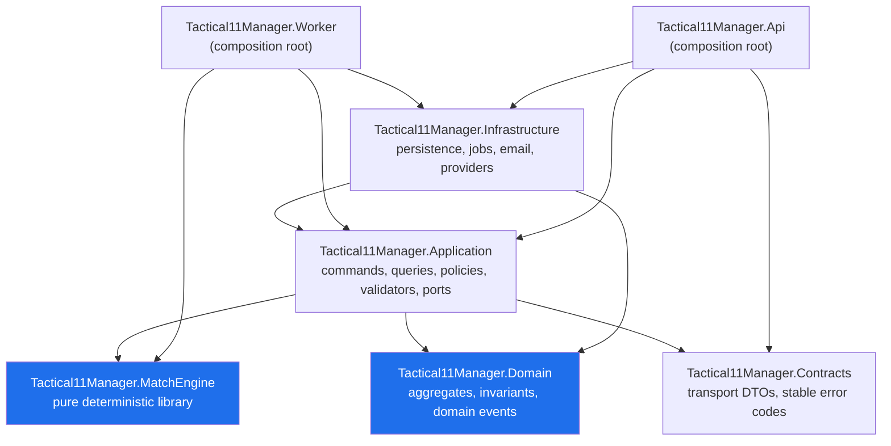

# Bounded Modules

> Companion to [ADR-0001](../architecture/adr/0001-modular-monolith.md). Defines the module
> boundaries, what each module owns, how modules may talk to each other, and which
> implementation stage delivers each one.

---

## 1. Module map

| Module | PostgreSQL schema | Owns | Primary stages |
|---|---|---|---|
| **auth** | `auth` | Accounts, credentials, sessions, email tokens, roles, consents, lockout, multi-factor credentials and recovery codes | 2, 13, 14 |
| **world** | `world` | World, countries, clubs, stadiums, structures (each club's snack bar and merchandise shop, with their takings history), managers, tenures, division provisioning, generation runs | 3, 11, Structures plan |
| **squad** | `squad` | Players, attributes, state, contracts, registrations, unavailability, tactical plans and slots, team sheets, training | 4, 8 |
| **competition** | `competition` | Seasons, divisions, division-seasons, club season entries, matchdays, fixtures, standings, player/club season stats, discipline | 6, 8, 12 |
| **match** | `match` | Input snapshots, matches, lineups, events, highlights, simulation attempts | 5, 6, 7 |
| **market** | `market` | Shortlists, transfer listings, bids, outcomes, AI market decisions | 10 |
| **finance** | `finance` | Club accounts, append-only ledger, season finance summaries | 9 |
| **fans** | `fans` | Each club's fan count and mood, the append-only history of what moved them, and what the fans expected from each fixture when the team sheets locked | 17 |
| **comms** | `comms` | Inbox messages, news items, email dispatch intent, direct messages between managers (conversations, messages, blocks), the community forum (threads, posts) | 6, 8, 11, Messages plan, Forum |
| **ops** | `ops` | Jobs, outbox, idempotency records, audit log, feature flags, repair actions, the read-only operational funnels and their counters, the operator game-health read, the console's job, matchday, and audit reads, and the local telemetry stack's dashboards and SLO alert rules | 1, 6, 13, 14 |

Logical model detail is in [`data-model.md`](data-model.md) and master plan §6.

---

## 2. Project dependency direction

Enforced by architecture tests (`tests/Tactical11Manager.ArchitectureTests`). A violation fails
the build.

### Rules

| Rule | Statement |
|---|---|
| DEP-1 | `Domain` depends on **nothing** — no Application, Infrastructure, ASP.NET, EF Core, or UI package. |
| DEP-2 | `MatchEngine` is pure. It may depend on domain-neutral contracts only. It may not depend on EF Core, `IClock`, network, filesystem, culture, or framework randomness. |
| DEP-3 | `Application` depends on Domain, MatchEngine abstractions, and Contracts. It contains commands, queries, policies, validators, and ports. |
| DEP-4 | `Infrastructure` implements persistence, jobs, email, auth storage, and external providers. |
| DEP-5 | `Api` and `Worker` are composition roots and contain **no game formulas**. |
| DEP-6 | `Contracts` contains versioned transport DTOs and stable error codes, never entities. |
| DEP-7 | `MatchEngine` never depends on `Infrastructure` or `Api`/`Worker`, and neither composition root may reimplement engine logic. |
| DEP-8 | No project may reference `apps/*` from `src/*`. |

---

## 3. Module interaction rules

| Rule | Statement |
|---|---|
| MOD-1 | A module's tables are written only by that module's code. |
| MOD-2 | Cross-module writes happen through an application use case, never through a controller or job handler reaching into another module's repository. |
| MOD-3 | Cross-module reads may use a narrow read port or a projection query; they may not mutate. |
| MOD-4 | Cross-module side effects that must be atomic with the primary write use the outbox, written in the same transaction. |
| MOD-5 | A module's public surface is its application-layer commands, queries, and DTOs — never its entities or `DbContext`. |
| MOD-6 | Circular module dependencies are forbidden. Where a cycle seems necessary, the correct answer is a domain event via the outbox. |

### Declared interactions

| From → To | Kind | Example |
|---|---|---|
| world → auth | read | Verify the account is verified/active/suspended before a claim |
| world → competition | read/write via use case | Provisioning creates division-season entries and fixtures |
| world → finance | write via use case | Takeover ensures a club account exists; provisioning funds a new club |
| squad → world | read | Player registration and contracts reference a club |
| world → squad | write via use case | The AI evaluation gives a club no manager holds a side and a training plan |
| competition → squad | write via use case | Publication applies cards, injuries, fatigue, morale |
| competition → finance | write via use case | Publication posts gate revenue; rollover settles awards |
| match → squad | read at lock time | Freeze lineups, attributes, and state into a snapshot |
| match → competition | write via use case | Publication marks fixtures published and updates standings |
| market → squad | write via use case | Resolution moves registration and rewrites contracts |
| market → finance | write via use case | Reservations, payment, seller credit |
| competition → finance | write via use case | Publication also posts each home club's snack bar takings, right after the gate (`STRC-4`, ADR-0080) |
| finance → world | read | The weekly run reads each club's fans, mood and the levels of its two structures to credit the shop and charge the upkeep (`STRC-6`…`STRC-8`) |
| world → ops | write via use case | An upgrade order enqueues the timed job that finishes the work (`world.complete-structure-upgrade`), and its completion writes an inbox message through comms |
| competition → fans | write via use case | The lock freezes what each side's fans expect; publication moves both clubs' fans after the gate is posted; rollover gives the last verdict and the tier jump |
| world → fans | write via use case | A takeover resets the club's fans to its tier's opening numbers (`FAN-9`) |
| finance → fans | read | The gate is drawn by the fans and mood going into the match (`FIN-3`) |
| comms ← all | consumed events | Inbox/news from publication, transfers, discipline, deadlines |
| world → comms | read | A club's manager name and whether the account is closing, through the `IClubManagerLookup` port; direct messages never write `world.*` or `auth.*` (ADR-0079) |
| ops ← all | infrastructure | Jobs, outbox dispatch, idempotency, audit |

---

## 4. Where each kind of code lives

| Concern | Location | Never in |
|---|---|---|
| Game formula (ratings, money amounts, tie-breaks) | Domain or MatchEngine, driven by the versioned rule set | Endpoints, job handlers, SQL |
| Deadline decision | `ops.jobs` row + application use case | In-memory timers, cron expressions in code |
| Authorization of a manager command | Application policy + endpoint filter | Controller body checks, client |
| HTTP shape, status codes, Problem Details | Api project | Domain |
| SQL, indexes, migrations | Infrastructure | Api, Domain |
| Presentation, interpolation, canvas drawing | Angular renderer (framework-neutral TS) | Server |
| Operator repair | Explicit audited repair use case + `ops.repair_actions` | Ad-hoc SQL, hidden admin bypasses |

---

## 5. Module readiness by stage

| Stage | Modules touched | Exit artifact |
|---|---|---|
| 0 | — | This document set |
| 1 | ops | Walking skeleton: one no-op durable job end to end |
| 2 | auth | Full authentication lifecycle |
| 3 | world, auth, competition (shell), finance (accounts) | Six countries, 108 clubs, atomic takeover |
| 4 | squad | Legal 24-player squads, tactics, training, contracts |
| 5 | match (engine only, no database) | Pure engine + benchmark lab |
| 6 | competition, match, ops, comms | First server-authoritative playable slice |
| 7 | match (presentation), web viewer | Commentary + 2D highlights |
| 8 | competition, squad, comms | Discipline, injuries, AI match management |
| 9 | finance, squad | Ledger, wages, renewals, awards |
| 10 | market, finance, squad | Timed auctions, AI market |
| 11 | world, comms, competition | Pyramid growth, inbox, inactivity — *delivered: generic provisioning execution + backfill (`PYR-4`–`PYR-8`), the inactivity ladder (`OCC-1`–`OCC-3`), and the comms completion (news feed, preferences, deadline reminders, outbox)* |
| 12 | competition, finance, squad, world | Rollover and continuity — *delivered: the world-scoped resumable rollover state machine, promotion/relegation (`PR-1`–`PR-6`), and next-season generation (ADR-0031), plus the continuity work — contract expiry and AI renewal (`CON-6`, `CON-9`), announce-then-play retirement (`CON-10`), emergency replacements (`SQ-8`), the position award (`FIN-5`), the season finance summary (`FIN-19`), the `PYR-9` next-season provisioning target (ADR-0032), the club season-history and next-season read (`PR-4`, `PR-6`), player career stats derived from the season lines (`STA-2`), the promotion/relegation inbox message (`PR-1`, `COM-1`), and the world-seed club-identity fix (`PYR-11`, ADR-0033)* |
| 13 | web (all features), ops | Feature-complete PWA — *delivered: account sessions, export, and preferences (ADR-0036), PWA hardening and the offline boundary (ADR-0037), responsive layouts and the breakpoint suite (`F-44`, ADR-0038), the accessibility baseline and axe gate (`F-52`, ADR-0039), guided help and the first-steps surface (`F-53`, ADR-0040), and the privacy-safe operational funnels (`F-54`, ADR-0041)* |
| 14 | ops, security, auth, web | Hardened live operations — *delivered so far: role administration and the access-admin tool, TOTP multi-factor authentication with the two-step login, the gated admin surface, the operator read console over jobs, matchdays, and the audit trail, the operator recovery commands — job retry and cancel (with the terminal `cancelled` status) and matchday resume, the administrative repairs and broadcasts (`F-46`, `F-47`, ADR-0045), the load, supply-chain, and point-in-time restore drills (`F-49`, ADR-0046), the read-only incident mode that blocks manager writes while reads stay live (`F-51`, ADR-0047), and the local telemetry stack — the dashboards and the availability and latency SLO alerts, over the instruments that exist (`F-48`, ADR-0048) — with the on-call runbook (`F-46`, `F-47`, ADR-0042, ADR-0043, ADR-0044, ADR-0045, ADR-0046, ADR-0047, ADR-0048)* |
| 15–16 | web, ops | Closed beta, public MVP — *delivered so far (Stage 15): the non-production stepped clock and its test toolbar (`TIME-6`, `TIME-7`, ADR-0049), and the player-facing rules, privacy, terms, status, and support pages, with the public service status behind the product's first anonymous read (`GET /api/v1/status`, `F-55`, ADR-0050)* |
| 17 (structures) | world, finance, competition, comms, web | The snack bar and the merchandise shop: ten levels, timed upgrades, takings from the crowd, the result and the fans' mood, and weekly upkeep — *delivered: `STRC-1`–`STRC-9`, the Structures page (ADR-0080)* |
| 17 (fan base) | fans, competition, finance, world, web | Fan count and mood per club, the expectation before each match, the weekly review against the fans' hoped-for place, and the crowd and gate drawn from them — *delivered: `FAN-1`–`FAN-10`, the Fan Base page and the expectation chip (ADR-0078)* |
